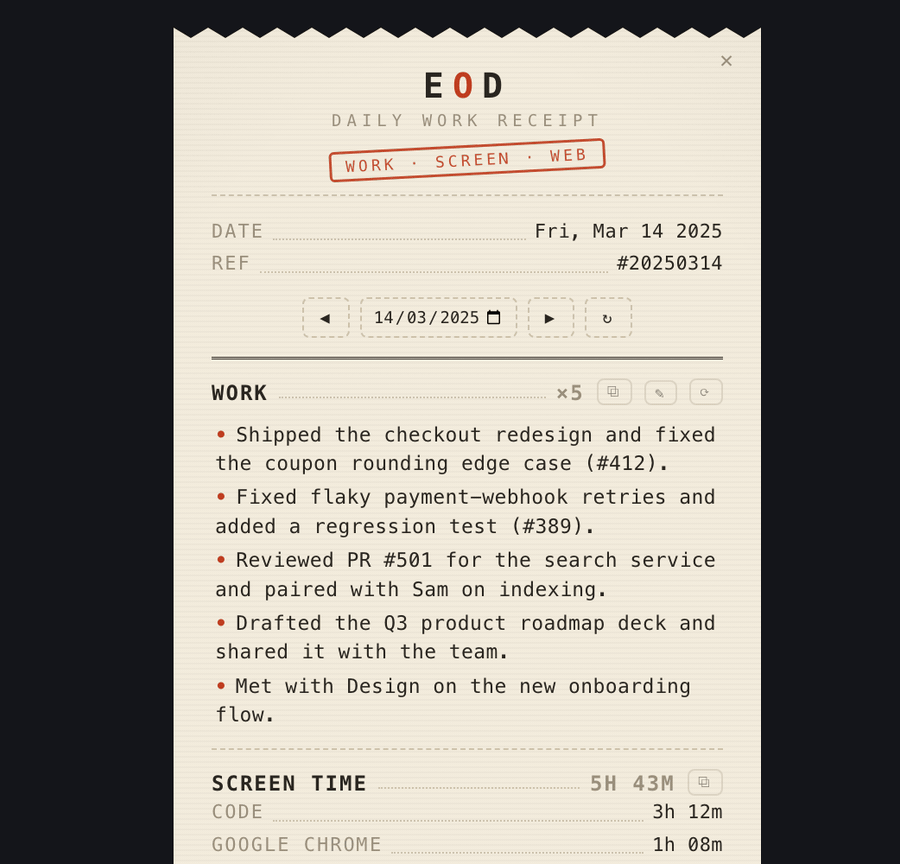

# EOD

By evening, the standup or timesheet asks what you did today and you rebuild it from memory; EOD prints it as a receipt from the files already on your Mac.

> [!TIP]
> **In daily use:** 5 people across the author's product and marketing team have used EOD for their end-of-day updates since mid-2026.

**Live demo: [eodreceipt.vercel.app](https://eodreceipt.vercel.app)**



> [!NOTE]
> **How I tested it: 10 made-up work days.** Before the test, I wrote down which facts each update must keep and what must never appear.
>
> | What was checked | Before fix | After fix |
> |---|---|---|
> | Facts kept (issue numbers, figures, names) | 30 / 30 | **30 / 30** |
> | Made-up numbers or names | 0 | **0** |
> | Personal browsing showing up in the update | 0 / 10 days | **0 / 10 days** |
> | Days where the update claimed more than really happened | 5 / 10 | **0 / 10** |
> | Days with 4 to 9 highlights, as the prompt asks (the other days had 3 or fewer work items) | 4 / 10 | **3 / 10** |
>
> On new cases (10 new days and 2 new weeks, answers written first, 3 runs, overstated claims checked by fixed rules): facts kept 38 / 38 and 10 / 10 every run; 0 / 10 days and 0 / 2 weekly summaries claimed more than happened (rules adjusted after first scores, see EVALS.md).
>
> Limits: in the table above I checked for overstated claims by reading the updates myself, and I wrote the prompt rules to fix those same misses. The new cases were written by Claude, not taken from real users. How it was done, and every miss: [EVALS.md](EVALS.md).

## Why AI here, why code there

The AI is deliberately minimal. Code does the work; a model only rewords it, and only if you let it.

| Step | Done by | Why |
|---|---|---|
| Reading transcripts, git, documents, browser history, calendar and screen time | Code | Plain file reads: local, repeatable and covered by tests. No model needed. |
| Grouping, de-duping, noise filtering and `exclude.txt` | Code | Privacy rules have to hold every time, so they are rules, not prompts. |
| Turning the day (and the week) into manager-ready bullets | Your `claude` CLI, optional | The one step where wording matters more than exactness. Skipped when nothing changed and never run with `polish.off`; the daily summary also runs at most once per 30 minutes on its own. |
| Fallback when the model is off, missing or fails | Code | The receipt still builds offline; a failed daily call keeps the last good summary. |

## Install

~3 minutes on macOS with [Hammerspoon](https://www.hammerspoon.org/) and `python3`. Full guide in **[INSTALL.md](INSTALL.md)**. Short version:

```sh
# don't already use Hammerspoon? drop EOD straight into its config:
mkdir -p ~/.hammerspoon && cp -R ./* ~/.hammerspoon/
```

Then open Hammerspoon → **Reload Config** (⌥⌃⌘R). The receipt prints down in the
top-right. (Already have an `init.lua`? Don't overwrite it; see INSTALL.md.)

## More

- [How it works](docs/how-it-works.md): where each section comes from, and the engine behind the widget
- [Privacy](docs/privacy.md): requirements, permissions, and exactly what the optional AI step sends
- [Configuration](docs/configuration.md): `exclude.txt`, `repos.txt`, `polish.off`, `signature.txt`, `send.txt`
- [Using EOD](docs/usage.md): features, controls and the `bin/eod` command line
- [Adding a source](docs/plugins.md): one file in `~/.eod/sources/`, no fork
- [Tests](docs/testing.md): the built-in test suite and the automatic checks that run on every change; each `claim:` marker in these docs has a test that must pass
- [Evals](EVALS.md): how the AI step was tested, the test days, and every miss

---

MIT licensed. Built by [@avinashgaurav](https://github.com/avinashgaurav).
