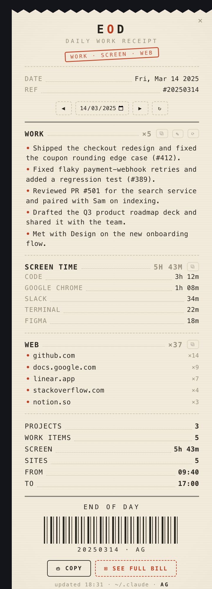
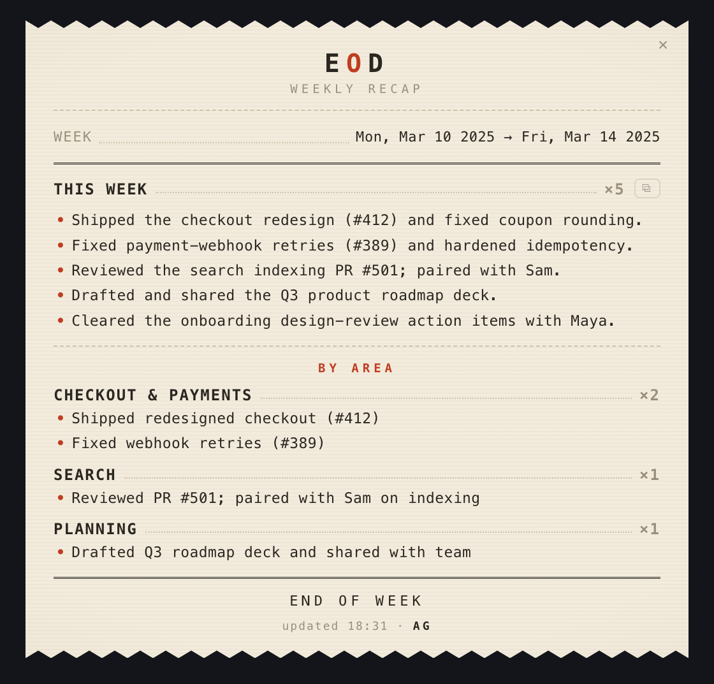

# How it works

A tiny macOS desktop widget, styled as a **printed receipt**, that shows
**everything you got done that day** (your AI coding sessions, the sites and
docs you worked in, the commits you shipped), grouped and copy-paste ready for a
standup, timesheet, or task sheet. It rebuilds itself from files already on your
Mac. Local-first, no API keys (see [Requirements & permissions](privacy.md#requirements--permissions)).

### Where it pulls from

| Source | Shows up as | Read from |
|---|---|---|
| **Claude Code** + **Codex** | **WORK**: your coding sessions, per project | their local JSONL transcripts |
| **Git** | shipped commits | repos in your work folders |
| **Documents** | decks / docs / sheets / PDFs you created or edited | your work folders |
| **Browsing** | **WEB**: the sites you spent time on | Chrome / Brave / Safari history |
| **Apps** | **SCREEN TIME** | the widget samples your frontmost app on a timer (skipping idle time) and saves per-app seconds to `cache/` |
| **GitHub** (optional) | pull requests you touched | the `gh` CLI, if installed (Homebrew paths) and signed in with `gh auth login` |
| **Calendar** (optional) | **MEETINGS** | `icalBuddy`, if installed (`brew install ical-buddy`) |

All local: nothing leaves your Mac (one optional exception, [see privacy.md](privacy.md#requirements--permissions)).

<p align="center">
  
  &nbsp;&nbsp;
  
</p>

<p align="center"><sub><b>Daily receipt</b> &nbsp;·&nbsp; <b>Weekly recap</b>: sample data; EOD builds these from your own activity, on your Mac.</sub></p>

Each line is the **work** done: the AI-generated session title from Claude Code
or Codex, a clean one-liner. The receipt never prints your raw prompts. <!--claim:receipt-no-raw-prompts-->
The **full bill** behind *See full bill* does show them, deliberately: it is the
verbose view, and like everything else on the card it never leaves your Mac.
(The optional AI-polish step does read them; see
[Requirements & permissions](privacy.md#requirements--permissions) for exactly what it sends.)

<details>
<summary>Prefer text? Here's what the receipt looks like.</summary>

```
        ✂ ‾‾‾‾‾‾‾‾‾‾‾‾‾‾‾‾‾‾
                 E O D
            DAILY WORK RECEIPT
        ────────────────────────
        DATE ......... Wed, Jun 24 2026
        ◀ PREV  NEXT ▶  ↻
        ════════════════════════
        EOD ................. ×2
          • Build the daily EOD widget       09:12
          • Add the print/roll animation     15:30
        GIT-CITY ............ ×1
          • Repo → 3D city skyline           11:55
        ────────────────────────
        PROJECTS ............ 2
        WORK ITEMS .......... 3
        ════════════════════════
             *** END OF DAY ***
            ▌▏▌▎▌▌▏▎▌▏▌▎▌
              [ ⎙ COPY ALL ]
        ✂ ____________________
```

</details>

## The engine and the widget

- **`extract.py`** is the entry point; the engine lives in the `eod/` package, one
  module per source. It parses every Claude Code and Codex `*.jsonl` transcript for
  the target day, takes each session's AI title, de-dupes per project, folds in git
  commits, pull requests, meetings, documents, browser history and app usage, filters
  noise, and writes a self-contained receipt HTML to `cache/`.
- **`eod.lua`** is a Hammerspoon module that renders that HTML in a frameless
  `hs.webview`, runs the engine on a timer, and handles copy / nav / drag / animation.
